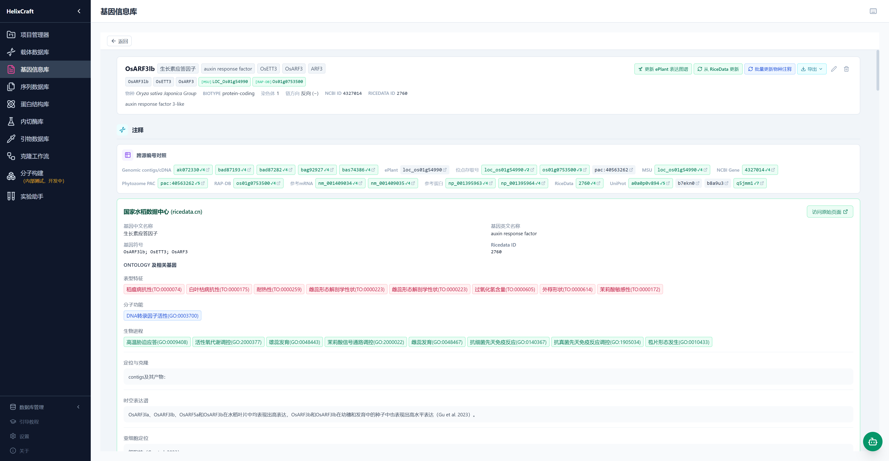
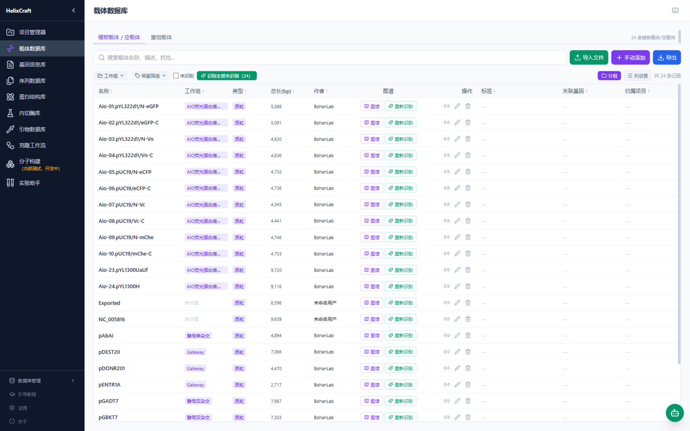
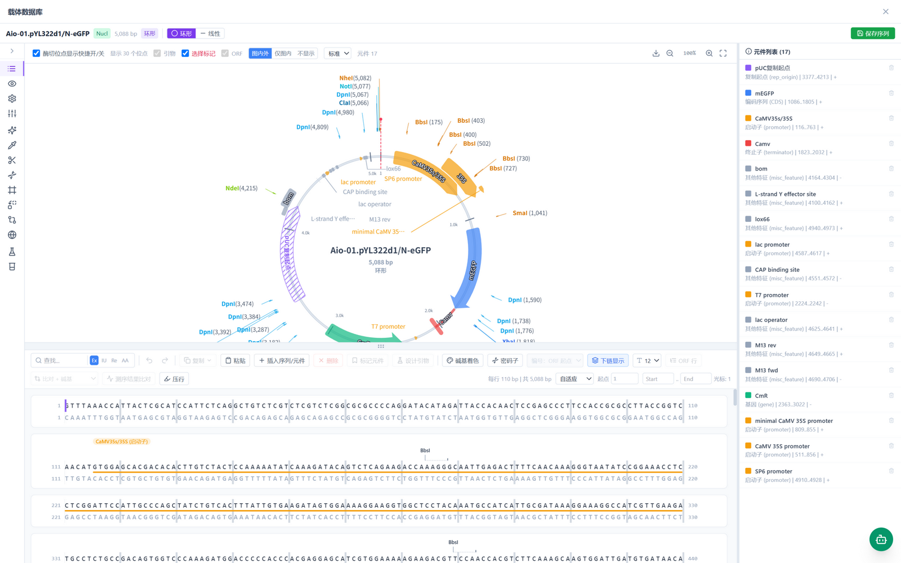
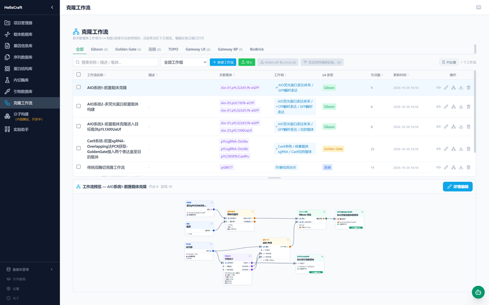
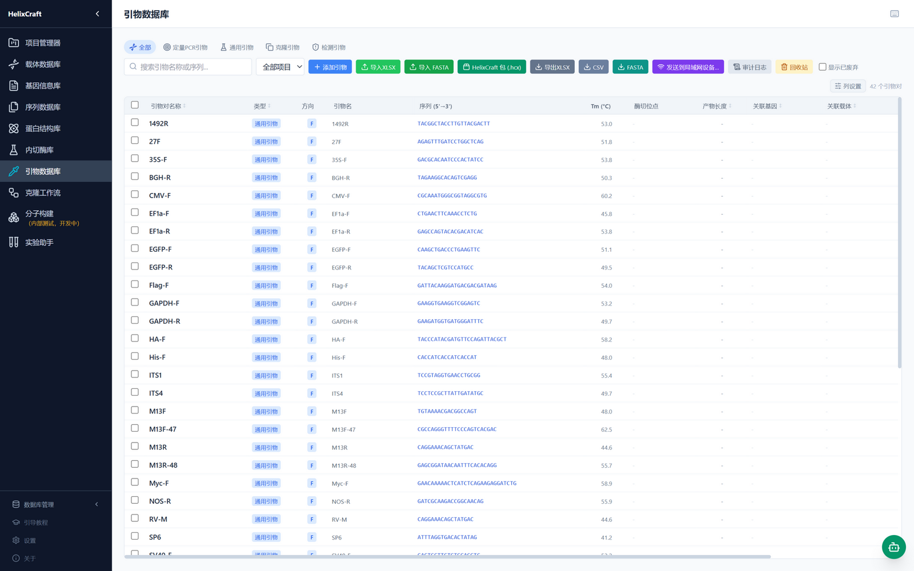
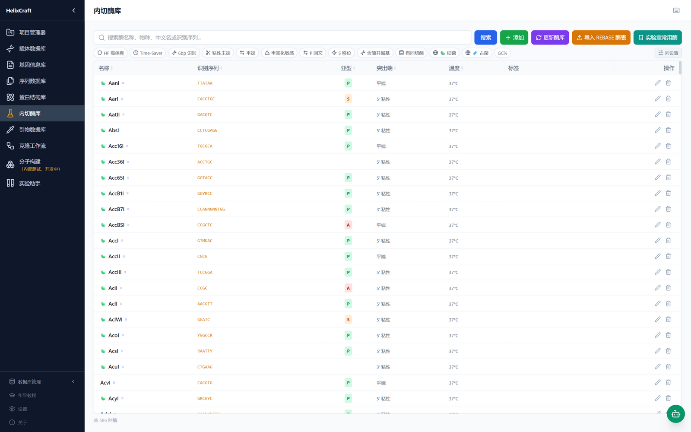
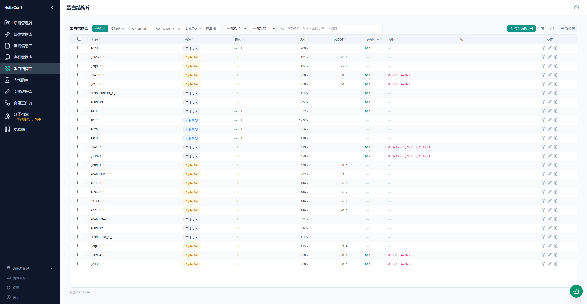
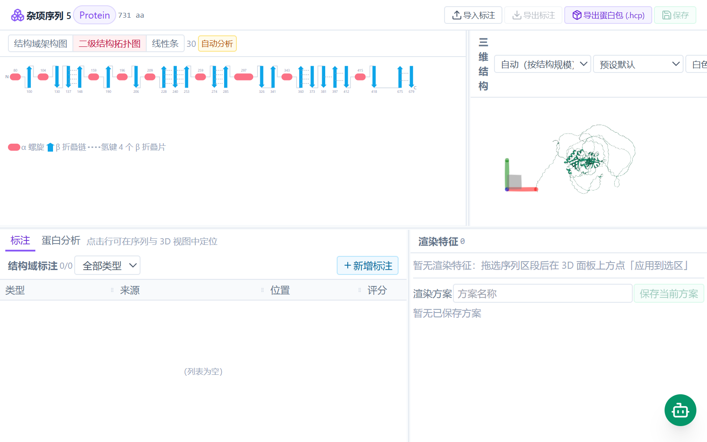
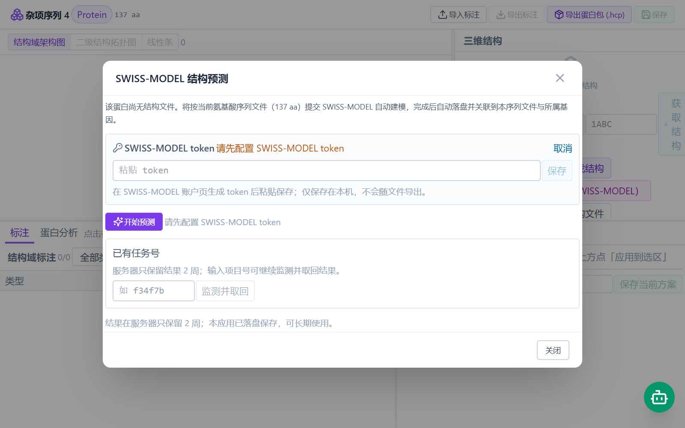
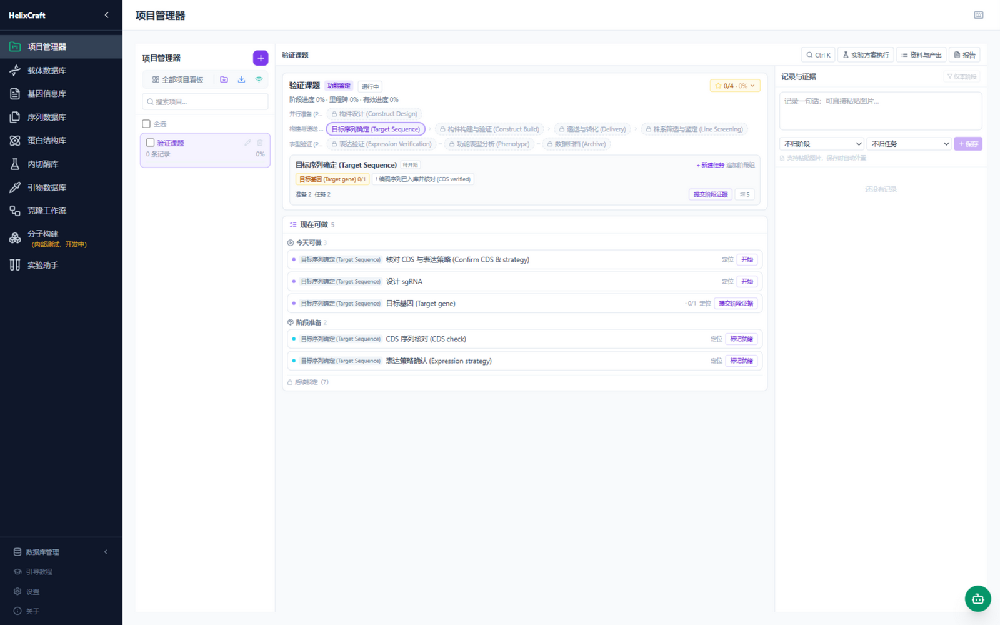

# HelixCraft

**Desktopová aplikace pro genové inženýrství posílená umělou inteligencí** · AI-powered gene engineering tools

[简体中文](README.md) · [English](README_EN.md) · [日本語](README_ja.md) · [한국어](README_ko.md) · [Français](README_fr.md) · [Deutsch](README_de.md) · [Español](README_es.md) · [Português](README_pt.md) · [Русский](README_ru.md) · [Italiano](README_it.md) · [العربية](README_ar.md) · [हिन्दी](README_hi.md) · [ไทย](README_th.md) · [Tiếng Việt](README_vi.md) · [Bahasa Indonesia](README_id.md) · [Türkçe](README_tr.md) · [Nederlands](README_nl.md) · [Polski](README_pl.md) · [Svenska](README_sv.md) · **Čeština**

> HelixCraft je desktopová aplikace pro výzkum molekulární biologie a genového inženýrství. Pokrývá kompletní pracovní tok „vyhledat gen → přečíst sekvenci → navrhnout klonování → složit in silico → ověřit experimentem → spravovat data“: editaci map vektorů, analýzu sekvencí, návrh primerů, simulaci restrikčního štěpení a gelové elektroforézy, klonovací workflow, analýzu sekvenačních chromatogramů, analýzu proteinů i volitelného AI asistenta.
> Všechna data zůstávají na vašem počítači — bez registrace a bez závislosti na cloudu — a rozhraní je dostupné ve 20 jazycích.
>
> Kompletní dokumentace: [简体中文](README.md) · [English](README_EN.md)

## Co je nového ve v0.5.0

- **Predikce struktury SWISS-MODEL**: proteiny bez souboru struktury lze modelovat online z uložené sekvence aminokyselin; výsledek se uloží lokálně a propojí se se souborem sekvence a jeho genem. Existující úlohy lze obnovit podle ID projektu.
- **Řízení projektů ELN/LIMS**: evidence materiálů, strukturovaná měření, pracovní prostory etap, šablony, průběh a zprávy; **BLAST** online (s předkontrolou Primer-BLAST) a ověření celé sekvence s AI zprávou o sestavení.
- **Průvodce a platformy**: kurzem stylované prohlídky (kapitoly/přestávky); universal build macOS 13+ (Intel a Apple Silicon); rozhraní zůstává ve 20 jazycích.

## Klíčové funkce

- **Získávání informací o genech**: hledání v lokální knihovně, import NCBI Gene/accession, vyhledávání přes pluginy druhů (RAP-DB / MSU / RiceData, Ensembl Plants, Phytozome), křížové identifikátory a reference, expresní data (ePlant / Expression Atlas), anotace UniProt a stránka genu s alelami, fenotypy, GO/InterPro a literaturou.
- **Vektorové mapy a editace sekvencí**: propojená kruhová/lineární mapa a text sekvence; restrikční místa, vazba primerů, ORF a mutace jako překryvy; chytrá anotace komponent; export SVG/PDF/PNG v publikační kvalitě.
- **Návrh klonování**: workflow plátno s 30 uzly pro Gibson, Golden Gate, T4 ligaci, TA/TOPO, Gateway LR/BP a BioBrick; simulace PCR, štěpení a sestavení v reálném čase před prací v laboratoři.
- **Návrh primerů**: obecný, klonovací a qPCR režim s 50+ parametry, hodnocení Tm/GC/hairpin/dimer, strategie exonových spojů a kontrola off-target pomocí in-silico PCR.
- **Ověření sekvenování**: prohlížeč chromatogramů AB1, sestavení čtení CAP3, ověření celého řetězce rekombinantního vektoru (pokrytí, spoje, varianty, posun reference) s AI zprávou o sestavení, zarovnání ClustalW a stromy.
- **Analýza a simulace gelu**: detekce drah/pruhů hlubokým učením, kvantifikace velikosti fragmentu a množství DNA z markeru, virtuální gelová elektroforéza štěpení.
- **Struktura a analýza proteinů**: 3D prohlížeč Mol* pro RCSB PDB / AlphaFold DB a lokální soubory PDB/mmCIF, synchronizované pohledy topologie ↔ sekvence ↔ 3D, sekundární struktura DSSP, měření vzdáleností a barvení reziduí; **predikce SWISS-MODEL** bez struktury; fyzikálně-chemická analýza, lokalizace a PTM; proteinové balíčky `.hcp`.
- **Laboratorní data a spolupráce**: řízení projektů ELN/LIMS (materiály, strukturovaná měření, pracovní prostory etap, šablony, zprávy), databáze vektorů/genů/primerů/sekvenování, šifrovaný přenos LAN, automatické zálohy; kurzem stylované návody; volitelný AI asistent; rozhraní ve 20 jazycích.

## Snímky obrazovky

## K čemu se hodí

- Otevřete soubor s plazmidem, prohlédněte si jeho elementy a restrikční místa a vyexportujte mapu v kvalitě vhodné pro publikaci.
- Ještě před připravením reakce si v počítači kompletně nasimulujte plán Gibson / Golden Gate / štěpení s ligací.
- Navrhujte klonovací primery nebo qPCR primery přesahující spoje exonů, s hodnocením a odůvodněním každého návrhu.
- Prohlížejte sekvenační chromatogramy, skládejte čtení a porovnávejte výsledky zpět s rekombinantním vektorem.
- Anotujte a kvantifikujte dráhy a pruhy na fotografiích gelů.
- Analyzujte z proteinové sekvence fyzikálně-chemické vlastnosti, subcelulární lokalizaci, modifikace a 3D strukturu.
- Spravujte vektory, geny, primery a sekvenační soubory podle projektů, přenášejte je mezi počítači v laboratoři a pravidelně je zálohujte.

## Stažení

Nejnovější verze je vždy k dispozici v kanálu [**Releases · latest**](releases):

| Platforma | Instalační balíček | Způsob instalace |
|---|---|---|
| Windows 10 / 11 (x64) | `HelixCraft.Setup.<version>.exe` | Spusťte průvodce instalací dvojklikem |
| macOS 13+ (universal) | `HelixCraft.Setup.<version>.dmg` | Otevřete `.dmg` a přetáhněte HelixCraft do Applications |
| Debian / Ubuntu (x86_64) | `helixcraft_<version>_amd64.deb` | Dvojklikem předejte soubor grafickému instalátoru systému, nebo použijte `sudo apt install ./<soubor>` |

Kanál `latest` je zároveň zdrojem dat pro funkci „Zkontrolovat aktualizace“ v aplikaci a jeho soubory se při každé verzi nahrazují; starší verze najdete v [seznamu Releases](releases). Soubor `latest.json` ve stejné složce je aktualizační manifest používaný aplikací — uvádí název, velikost a otisk SHA-256 každého instalačního balíčku, takže můžete ověřit, že stažený soubor je kompletní a nezměněný.

## Instalace

### Windows

- Spusťte dvojklikem `HelixCraft.Setup.<version>.exe` a dokončete instalaci v průvodci (výchozí instalace pro všechny uživatele, vyžaduje oprávnění správce).
- Průvodce nabízí volitelnou součást **ukázková data** (ukázkové vektory, klonovací workflow a pluginy druhových dat) pro rychlé seznámení; importují se jen tehdy, pokud daný obsah ještě neexistuje — **nikdy nepřepíšou data, která jste si vytvořili**.
- **Instalace přes stávající verzi zachová všechna data**: data žijí v `%APPDATA%\HelixCraft` (databáze druhů v `%APPDATA%\HelixCraftData`) a odinstalace je nemaže.

### macOS

- Požadavky: macOS 13 nebo novější (universal: Intel a Apple Silicon).
- Otevřete `HelixCraft.Setup.<version>.dmg` a přetáhněte **HelixCraft** do **Applications**.
- Build je ad-hoc podepsaný (ne notarizovaný): při prvním spuštění klikněte na aplikaci pravým tlačítkem a zvolte **Otevřít** (nebo ji povolte v Nastavení systému → Soukromí a zabezpečení). Uživatelská data jsou v `~/Library/Application Support/HelixCraft` a při odinstalaci se neodstraňují.

### Linux (Debian / Ubuntu, x86_64)

- Dvojklik na soubor `.deb` jej předá grafickému instalátoru systému (GNOME Software / App Center / KDE Discover / GDebi), případně použijte příkaz `sudo apt install ./helixcraft_<version>_amd64.deb`.
- Program se instaluje do `/opt/HelixCraft`, uživatelská data do `~/.config/HelixCraft`; **odinstalací se nesmažou**.
- Doporučujeme mít v systému nainstalovaná písma CJK (balíček deklaruje `Recommends: fonts-noto-cjk`).

## Online aktualizace

Asi 20 sekund po spuštění zkontroluje aplikace na pozadí aktualizace (ve výchozím nastavení zapnuté, nejvýše jednou za 24 hodin, v nastavení lze vypnout). Nová verze se pouze oznámí — **nic se nestahuje automaticky**; stahování probíhá přes HTTPS s obnovou přerušeného přenosu a kontrolou SHA-256. Na Windows instalaci dokončí průvodce NSIS a aplikace se automaticky restartuje, na Linuxu se stažený soubor `.deb` předá instalátoru systému.

## Hlavní funkce

- **Mapy vektorů** — kruhová a lineární mapa obousměrně propojená se sekvenčním textem; styl (barvy, velikosti písem, legenda, zobrazení prvků) volně přizpůsobitelný, export do SVG / PDF / PNG pro publikace.
- **Přímá editace sekvence** — psaní, mazání i vkládání s automatickým posunem souřadnic elementů; všechny operace sekvence i elementů podporují 50 kroků undo/redo.
- **Chytrá anotace** — porovnání celé sekvence vektoru s databází elementů automaticky rozpozná známé elementy a odvodí antibiotickou rezistenci, hostitele, promotor či reportérový gen (s mírou jistoty a důkazy; stávající údaje se nepřepisují).
- **Predikce ORF** ve všech šesti čtecích rámcích (včetně ORF přesahujících origin kruhových plazmidů) a **online vyhledávání BLAST** — vybranou sekvenci odešlete přímo na NCBI.
- **Simulace štěpení a virtuální elektroforéza** — fragmenty pro jedno i více enzymů v reálném čase, gelová simulace s 11 běžnými markery a volbou koncentrace agarózy, napětí a doby běhu; automatická kontrola metylace (Dam / Dcm / CpG) a průvodce volbou restrikčních míst.
- **Plátno klonovacích workflow** — experiment pospojujete jako vývojový diagram (30 typů uzlů od sekvenčních zdrojů přes virtuální PCR a skládání až po uložení do databáze), výstupy uzlů se počítají v reálném čase; strategie Gibson, Golden Gate, T4 ligace, TA / TOPO, Gateway LR / BP a BioBrick, navíc samostatné plátno pro molekulární konstrukce.
- **Návrh primerů** — univerzální návrh s 50+ nastavitelnými parametry a dvacítkou nejlepších kandidátů se skóre; průvodce qPCR s automatickým zarovnáním mRNA na genom se zohledněním sestřihu a se skóre shody s MIQE; databáze primerů s historií změn.
- **Analýza sekvenování** — prohlížeč chromatogramů AB1, automatické skládání čtení Sanger (CAP3), ověření rekombinantních vektorů zarovnáním čtení na vektor, vícenásobné zarovnání (ClustalW) a fylogenetické stromy.
- **Analýza obrazů gelů** — model hlubokého učení rozpozná dráhy a pruhy; z kalibrační křivky velikostí určí velikost fragmentu a množství DNA metodou integrované optické hustoty (IOD).
- **Analýza proteinů** — tři propojená zobrazení (topologie ↔ sekvence ↔ 3D struktura z RCSB PDB / AlphaFold DB); místní analýza vlastností, subcelulární lokalizace a modifikací během sekund, online upřesnění pomocí InterProScan.
- **Správa laboratorních dat** — pět databází (vektory, sekvence, primery, enzymy s 580+ restrikčními enzymy a projekty), sdílení balíčky `.hcvec`, šifrovaný přenos mezi počítači v místní síti přes osmimístný párovací kód, automatické zálohy a mazání s ochranou.
- **Volitelný AI asistent** — rozumí textovému popisu klonovacího plánu a umí software ovládat; bez nastavení AI zůstává každá funkce plně dostupná ručně.

## Pluginy druhových dat

Anotace genů a expresní data se připojují prostřednictvím „pluginů druhových dat“, které lze v nastavení instalovat, povolovat a odinstalovat. Instalační balíček obsahuje anotace rýže (asi 100 000 záznamů); data získaná online se automaticky ukládají do místní mezipaměti a zůstávají dostupná i offline.

- **Rice (rýže)** — RAP-DB, MSU-RGAP, RiceData, RiceXPro: anotace lokusů, struktura exonů, synonyma, fenotypy mutantů, expresní mapy v čase a prostoru, sekvence všech verzí a vzájemný převod ID mezi databázemi.
- **Ensembl Plants** — Ensembl Plants a EBI Expression Atlas: vyhledávání genů ve 100+ druzích, stahování sekvencí, GO anotace a exprese RNA-Seq.
- **Phytozome** — JGI Phytozome: vyhledávání genů, genové modely, sekvence CDS / cDNA / proteinů, domény a homologické geny.
- **ePlant (BAR)** — BAR eFP Browser: barevné piktogramy tkáňové exprese a exprese po jednotlivých tkáních pro 13 druhů.

## Bezpečnost dat a soukromí

- **Všechna data zůstávají na vašem počítači**: na servery se nic nenahrává; k síti se aplikace připojí jen tehdy, když si sami vyžádáte online data (NCBI, databáze druhů, struktury proteinů, aktualizace softwaru).
- **AI je plně volitelná**: API klíč se ukládá pouze lokálně; i bez něj má každá funkce ruční cestu.
- **Slučování nikdy nepřepisuje**: ukázková data, importované balíčky i příjem přes místní síť pouze doplňují prázdná pole; váš stávající obsah zůstává nedotčen.

## Podporované formáty souborů

| Směr | Formáty |
|------|------|
- **Predikce struktury SWISS-MODEL**: u proteinů bez souboru struktury modelujte aktuální sekvenci aminokyselin online; výsledek se uloží lokálně a propojí se se souborem sekvence a genem.
| Otevřít / importovat | GenBank (`.gb` `.gbk`), FASTA (`.fasta` `.fa` `.faa`), SnapGene (`.dna`), EMBL (`.embl`), chromatogramy (`.ab1`), Excel s primery (`.xlsx`), anotace proteinů (UniProtKB / GFF3 / InterProScan / GenPept), struktury proteinů (PDB / mmCIF), balíčky HelixCraft (genový balíček / vektorový balíček `.hcvec` / proteinový balíček `.hcp`) |
| Uložit / exportovat | GenBank, FASTA, SnapGene `.dna`, EMBL, obrázky map (SVG / PDF / PNG / JPG / BMP / TIF), anotované gely, Excel s primery, anotace proteinů v 6 formátech, genový datový balíček / `.hcvec` / `.hcp`, statická webová stránka s detaily genu, úplná záloha ZIP |

## Jazyky rozhraní

Všechny funkční moduly jsou od verze v0.3.7 kompletně přeloženy do 20 jazyků: 简体中文, English, 日本語, 한국어, Français, Deutsch, Español, Português, Русский, Italiano, العربية, हिन्दी, ไทย, Tiếng Việt, Bahasa Indonesia, Türkçe, Nederlands, Polski, Svenska, Čeština. Jazyk lze kdykoli přepnout v „Nastavení → Jazyk“.

## O tomto repozitáři

Tento repozitář slouží výhradně k **distribuci instalačních balíčků a aktualizačního manifestu**, zdrojový kód neobsahuje. Release se štítkem `latest` je kanálem online aktualizací (soubory se při každé verzi nahrazují); releases se štítky `v<version>` jsou archivem starších verzí. Tentýž repozitář je synchronně hostován na [GitHubu](https://github.com/liudab/HelixCraft) a [GitCode](https://gitcode.com/BohanLab/HelixCraft), instalační balíčky se zveřejňují na obou.

## Licence

[MIT](LICENSE)

## Kontakt

Bohan Liu @ BohanLab · liubohan@hunau.edu.cn
