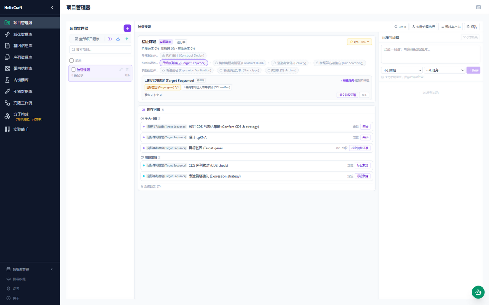
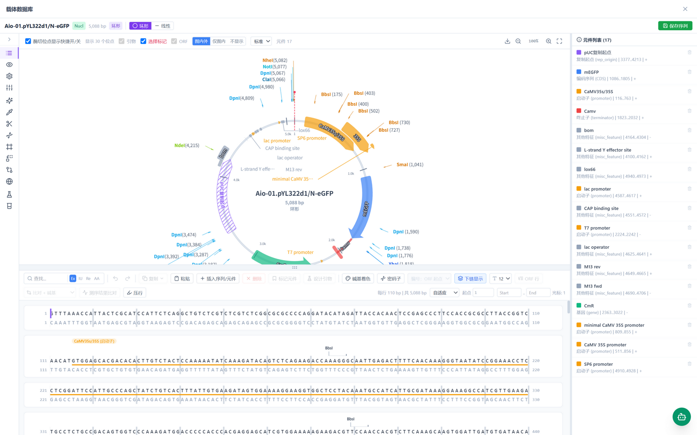
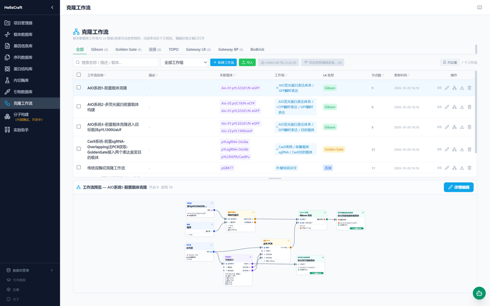
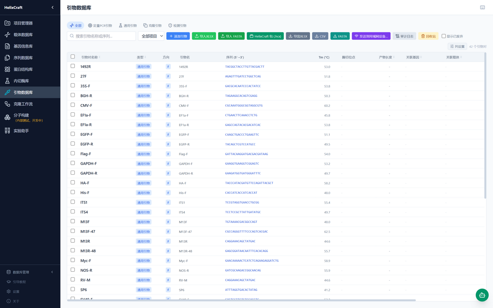

# HelixCraft

Software de escritorio de ingeniería genética asistido por IA · AI-powered gene engineering tools

[简体中文](README.md) · [English](README_EN.md) · [日本語](README_ja.md) · [한국어](README_ko.md) · [Français](README_fr.md) · [Deutsch](README_de.md) · **Español** · [Português](README_pt.md) · [Русский](README_ru.md) · [Italiano](README_it.md) · [العربية](README_ar.md) · [हिन्दी](README_hi.md) · [ไทย](README_th.md) · [Tiếng Việt](README_vi.md) · [Bahasa Indonesia](README_id.md) · [Türkçe](README_tr.md) · [Nederlands](README_nl.md) · [Polski](README_pl.md) · [Svenska](README_sv.md) · [Čeština](README_cs.md)

> HelixCraft es un software de escritorio para la investigación en biología molecular e ingeniería genética que cubre el flujo de trabajo completo: buscar el gen → leer la secuencia → diseñar la clonación → ensamblaje in silico → verificación experimental → gestión de datos. Incluye edición de mapas de vectores, análisis de secuencias, diseño de cebadores, simulación de digestiones de restricción y de electroforesis en gel, flujos de trabajo de clonación, análisis de cromatogramas de secuenciación, análisis de proteínas y un asistente de IA opcional. Todos los datos se guardan en tu propio equipo: no hace falta registrarse ni depender de la nube, y la interfaz está disponible en 20 idiomas.
> Documentación completa: [简体中文](README.md) · [English](README_EN.md)

## Novedades de la v0.5.0

- **Predicción de estructura SWISS-MODEL**: las proteínas sin archivo de estructura pueden modelarse en línea a partir de la secuencia de aminoácidos guardada; el resultado se guarda localmente y se vincula al archivo de secuencia y a su gen. Los trabajos existentes pueden reanudarse por ID de proyecto.
- **Gestión de proyectos ELN/LIMS**: registro de materiales, mediciones estructuradas, espacios de trabajo por etapa, plantillas, progreso e informes; **BLAST** en línea (con precomprobación Primer-BLAST) y verificación completa de la secuencia con informe de construcción por IA.
- **Guía y plataformas**: tutoriales guiados tipo curso (capítulos/pausas); compilación universal para macOS 13+ (Intel y Apple Silicon); la interfaz sigue en 20 idiomas.

## Funciones clave

- **Obtención de información génica**: búsqueda en la base local, importación de NCBI Gene/accession, búsqueda mediante plugins de especie (RAP-DB / MSU / RiceData, Ensembl Plants, Phytozome), IDs y referencias cruzadas, datos de expresión (ePlant / Expression Atlas), anotaciones UniProt y una página de gen con alelos, fenotipos, GO/InterPro y referencias.
- **Mapas de vectores y edición de secuencias**: mapa circular/lineal enlazado con el texto de secuencia; sitios de restricción, unión de cebadores, ORF y mutaciones superpuestos; anotación inteligente de componentes; exportación SVG/PDF/PNG de calidad publicación.
- **Diseño de clonación**: lienzo de flujo con 30 nodos para Gibson, Golden Gate, ligación T4, TA/TOPO, Gateway LR/BP y BioBrick; simulación en tiempo real de PCR, digestión y ensamblaje antes del banco.
- **Diseño de cebadores**: modos general, clonación y qPCR con 50+ parámetros, puntuación Tm/GC/horquilla/dímero, estrategias de unión exón-exón y comprobación de off-target por PCR in silico.
- **Verificación de secuenciación**: visor de cromatogramas AB1, ensamblaje de lecturas CAP3, verificación completa del vector recombinante (cobertura, uniones, variantes, deriva de referencia) con informe de construcción por IA, alineamiento ClustalW y árboles.
- **Análisis y simulación de geles**: detección de carriles/bandas por aprendizaje profundo, cuantificación de tamaño y cantidad de ADN a partir de un marcador, electroforesis virtual de digestiones.
- **Estructura y análisis de proteínas**: visor 3D Mol* para RCSB PDB / AlphaFold DB y archivos PDB/mmCIF locales, vistas topología ↔ secuencia ↔ 3D sincronizadas, estructura secundaria DSSP, medición de distancias y coloración de residuos; **predicción SWISS-MODEL** sin estructura; análisis fisicoquímico, de localización y PTM; paquetes `.hcp`.
- **Datos de laboratorio y colaboración**: gestión de proyectos ELN/LIMS (materiales, mediciones estructuradas, espacios por etapa, plantillas, informes), bases de vectores/genes/cebadores/secuenciación, transferencia LAN cifrada, copias automáticas; tutoriales guiados; asistente IA opcional; interfaz en 20 idiomas.

## Capturas de pantalla

## ¿Qué puedes hacer con HelixCraft?

- Abrir un archivo de plásmido y ver de un vistazo la composición de sus elementos y sus sitios de restricción, y exportar figuras del mapa listas para una publicación.
- Simular por completo en el equipo un plan de Gibson / Golden Gate / ligación con enzimas de restricción antes de montar una sola reacción.
- Diseñar cebadores de clonación o cebadores qPCR que abarcan uniones de exones, con puntuaciones y evidencias que respaldan cada diseño.
- Revisar cromatogramas de secuenciación, ensamblar lecturas y comprobar los resultados alineándolos de vuelta contra el vector recombinante.
- Anotar carriles y bandas en fotografías de geles y cuantificarlas.
- Partiendo de una secuencia proteica, analizar sus propiedades fisicoquímicas, su localización subcelular, sus sitios de modificación y su estructura tridimensional.
- Organizar vectores, genes, cebadores y archivos de secuenciación por proyecto, transferirlos entre los equipos del laboratorio y respaldarlos periódicamente.

## Descarga

La versión más reciente siempre está publicada en el canal [**Releases · latest**](releases):

| Plataforma | Instalador | Cómo instalar |
|---|---|---|
| Windows 10 / 11 (x64) | `HelixCraft.Setup.<version>.exe` | Doble clic para ejecutar el asistente de instalación |
| macOS 13+ (universal) | `HelixCraft.Setup.<version>.dmg` | Abre el `.dmg` y arrastra HelixCraft a Aplicaciones |
| Debian / Ubuntu (x86_64) | `helixcraft_<version>_amd64.deb` | Doble clic para entregarlo al instalador gráfico del sistema, o `sudo apt install ./<archivo>` |

El canal `latest` es también la fuente de datos de la función «Comprobar actualizaciones» de la aplicación, y sus archivos se reemplazan por completo en cada versión; las versiones históricas se conservan en la [lista de Releases](releases). Junto a los instaladores, `latest.json` es el manifiesto de actualización que usa la aplicación: enumera el nombre, el tamaño en bytes y el resumen SHA-256 de cada instalador, de modo que puedes verificar que la descarga está completa y no ha sido manipulada.

## Instalación

### Windows

- Ejecuta `HelixCraft.Setup.<version>.exe` y sigue el asistente (por defecto se instala para todos los usuarios y requiere permisos de administrador).
- El asistente ofrece un componente opcional de **datos de ejemplo** (vectores de ejemplo, flujos de trabajo de clonación y complementos de especies); los datos de ejemplo solo se importan cuando el contenido correspondiente no existe aún y **nunca sobrescriben los datos que ya hayas creado**.
- **Instalar sobre una copia existente conserva todos los datos.** El directorio de datos es `%APPDATA%\HelixCraft` (las subbases de datos de especies están en `%APPDATA%\HelixCraftData`); la desinstalación no lo elimina.

### macOS

- Requisitos: macOS 13 o posterior (universal: Intel y Apple Silicon).
- Abre `HelixCraft.Setup.<version>.dmg` y arrastra **HelixCraft** a **Aplicaciones**.
- La compilación está firmada ad-hoc (sin notarizar): en el primer inicio, haz clic derecho en la app y elige **Abrir** (o permítela en Ajustes del Sistema → Privacidad y seguridad). Los datos de usuario están en `~/Library/Application Support/HelixCraft` y no se eliminan al desinstalar.

### Linux (Debian / Ubuntu, x86_64)

- Al hacer doble clic sobre el `.deb` se entrega al instalador gráfico del sistema; el comando equivalente en la terminal es `sudo apt install ./helixcraft_<version>_amd64.deb`.
- El programa se instala en `/opt/HelixCraft` y los datos de usuario quedan en `~/.config/HelixCraft`; **la desinstalación no los elimina**.
- Se recomienda tener instaladas fuentes CJK en el sistema.

## Actualización en línea

Unos 20 segundos después del arranque, la aplicación comprueba en segundo plano si hay actualizaciones (activado por defecto, como mucho una vez cada 24 horas; se puede desactivar en la configuración). Si existe una versión nueva solo se avisa, **no se descarga nada automáticamente**. La descarga se realiza por HTTPS, con reanudación de transferencias y verificación SHA-256; en Windows la instalación la completa el asistente NSIS y la aplicación se reinicia sola, y en Linux el `.deb` descargado se entrega al instalador de software del sistema.

## Funciones principales

- **Mapa de vectores y edición de secuencias**: vistas circular y lineal enlazadas en ambos sentidos con el texto de la secuencia; elementos coloreados por tipo, con sitios de restricción, posiciones de unión de cebadores, ORF y marcadores de mutación superpuestos; estilos personalizables (colores, tamaños de fuente, leyenda, visibilidad) y exportación a SVG / PDF / PNG para figuras de publicación. La secuencia se edita directamente (teclear, borrar, pegar), con reajuste automático de las coordenadas de los elementos y 50 pasos de deshacer/rehacer.
- **Anotación inteligente**: compara el vector completo con la base de datos de elementos para reconocer los conocidos (solo se aceptan con ≥99 % de identidad de ADN o ≥90 % de coincidencia en la traducción, con previsualización elemento a elemento antes de la importación en lote) e infiere automáticamente campos como resistencia a antibióticos, hospedador, promotor y gen reportero, con nivel de confianza y evidencias, sin sobrescribir la información existente.
- **Predicción de ORF y búsqueda BLAST en línea**: barrido de los seis marcos de lectura (incluidos los ORF que cruzan el origen en plásmidos circulares) y envío de cualquier selección a NCBI (blastn / blastp / blastx y otros programas).
- **Simulación de digestiones y electroforesis virtual en gel**: listas de fragmentos en tiempo real para digestiones simples, dobles o múltiples, incluidos los sitios que cruzan el origen; los resultados se envían con un clic a la simulación de gel (marcadores habituales como DL2000 o 1 kb Ladder, concentración de agarosa, voltaje y tiempo de corrida, con modelos de migración calibrados con la literatura); el efecto de la metilación (Dam / Dcm / CpG) se comprueba automáticamente y un asistente recomienda sitios de restricción candidatos.
- **Lienzo de flujos de trabajo de clonación**: el experimento se conecta como un diagrama de flujo —fuente de secuencias → diseño de cebadores / optimización de codones → PCR virtual → digestión / purificación → ensamblaje → transformación / PCR de colonias / verificación por secuenciación → guardar en la base de datos— con 30 tipos de nodos cuyas salidas se calculan en tiempo real; admite Gibson, Golden Gate (con recomendación de bases protectoras), ligación T4, clonación TA / TOPO, Gateway LR / BP y BioBrick, además de deshacer/rehacer, autoguardado e importación/exportación JSON.
- **Lienzo de construcción molecular (Beta)**: para el diseño del tipo «elige un esqueleto y añade elementos»; se escoge el esqueleto en la biblioteca de vectores, se rellenan los huecos con componentes y se elige el método de ensamblaje, y la aplicación genera la estrategia de linearización, todas las secuencias de cebadores, la mezcla de ensamblaje y las sugerencias de verificación; el producto solo se guarda si coincide base a base con el diseño.
- **Diseño de cebadores general y qPCR**: tres modos y más de 50 parámetros ajustables (Tm, GC, longitud del producto, estabilidad del extremo 3′…), con los 20 mejores candidatos puntuados (Tm, GC %, riesgos de horquilla y dímeros, y una puntuación global sobre 100); el asistente de qPCR alinea automáticamente el ARNm con el genoma (splicing), dibuja la estructura de exones y diseña por estrategias graduadas —primero cebadores que abarcan la unión de exones, luego amplicones que cruzan intrones—, con puntuación de cumplimiento MIQE y asociación al gen al guardar; cualquier pareja de cebadores puede verificarse con PCR in silico, y las parejas se gestionan en la biblioteca de cebadores con importación/exportación a Excel.
- **Análisis de secuenciación**: visor de cromatogramas AB1 con las cuatro curvas de fluorescencia y los valores de calidad, cotejables base a base con una referencia; ensamblaje automático de lecturas Sanger (algoritmo CAP3) con secuencia consenso, profundidad de cobertura y aviso de zonas de baja calidad; verificación de vectores recombinantes alineando las lecturas contra tu vector —eligiendo automáticamente la mejor orientación de hebra, también en vectores circulares que cruzan el origen— con un esquema de «elementos del vector + lecturas» coloreado por coincidencia; alineamiento múltiple (ClustalW) y construcción de árboles filogenéticos.
- **Análisis de imágenes de geles con IA**: en tres pasos se abre la foto del gel, un modelo de aprendizaje profundo integrado detecta carriles y bandas (se pueden añadir, quitar o arrastrar a mano) y, tras calibrar con el carril del marcador, entrega el **tamaño del fragmento y la cantidad de ADN** de cada banda (densidad óptica integrada), con figuras anotadas (PNG / JPG / BMP / TIF) y resultados en JSON exportables.
- **Análisis de proteínas**: tres vistas enlazadas (esquema de topología ↔ panel de secuencia ↔ estructura 3D recuperada de RCSB PDB / AlphaFold DB) donde cualquier clic resalta a la vez secuencia y estructura; análisis local en segundos (peso molecular, punto isoeléctrico, hidrofobicidad, composición, localización subcelular, siete clases de sitios de modificación postraduccional, regiones desordenadas o de baja complejidad…); refinamiento en línea con InterProScan y BLAST que transfiere a tu secuencia anotaciones curadas de Swiss-Prot (solo añade información, sin sobrescribir lo local).
- **Gestión de datos de laboratorio**: cinco bases de datos (vectores, secuencias, cebadores, enzimas —más de 580 enzimas de restricción— y proyectos); los grupos de trabajo de vectores se empaquetan en un `.hcvec` para compartir, dos equipos de la misma red local pueden intercambiar datos cifrados mediante un código de emparejamiento de 8 dígitos (el receptor solo rellena campos vacíos), hay copias de seguridad automáticas al arrancar, copia completa manual y restauración con un clic, y el borrado está protegido: primero enumera todos los datos afectados y tú decides el alcance.
- **Asistente de IA opcional**: funciona con cualquier punto de acceso compatible con OpenAI (la clave API solo se guarda en tu equipo); conoce el gen, el vector o la ventana que tienes abiertos y puede cambiar de página, localizar entidades y consultar o modificar datos por los mismos pasos que la edición manual (por tanto, deshacibles); interpreta textos de protocolos de clonación y extrae un plan estructurado, pero **la IA solo entiende texto y nunca genera una sola base**. Sin configurar la IA, todas las funciones conservan su vía completamente manual.

## Complementos de datos de especies

Las anotaciones de genes y los datos de expresión se incorporan mediante «complementos de especies», que se instalan, activan y desinstalan desde la página de configuración. El instalador incluye datos de anotación del arroz (unas 100 000 entradas); lo que se obtiene en línea se guarda automáticamente en local y después se lee de la caché, de modo que también puede consultarse sin conexión:

- **Arroz (Rice)** — RAP-DB, MSU-RGAP, RiceData y RiceXPro: anotación de loci, estructura de exones, sinónimos, fenotipos de mutantes, mapas de expresión espacio-temporales (valores e imágenes), secuencias de todas las versiones y conversión de identificadores entre bases de datos.
- **Ensembl Plants** — Ensembl Plants y EBI Expression Atlas: búsqueda de genes en más de 100 especies, descarga de secuencias, anotaciones GO y expresión RNA-Seq.
- **Phytozome** — JGI Phytozome: búsqueda de genes, modelos génicos, secuencias CDS / cDNA / proteicas, dominios y genes homólogos.
- **ePlant (BAR)** — BAR eFP Browser: pictogramas en color de expresión tisular y niveles de expresión por tejido para 13 especies.

## Seguridad y privacidad de los datos

- **Todos los datos se almacenan localmente**: no se sube nada a ningún servidor; la conexión a la red solo se produce cuando tú pides datos en línea (NCBI, bases de datos de especies, repositorios de estructuras de proteínas o actualizaciones del software).
- **La IA es opcional y se puede desactivar por completo**: el asistente usa tu propia clave de API, que solo se guarda en tu equipo; sin IA, todas las funciones tienen su vía manual.
- **La combinación nunca sobrescribe**: instalar datos de ejemplo, importar paquetes o recibir transferencias por la red local solo rellena los campos vacíos, sin tocar tu contenido existente.

## Formatos de archivo compatibles

| Dirección | Formatos |
|------|------|
- **Predicción de estructura SWISS-MODEL**: para proteínas sin archivo de estructura, modela en línea la secuencia de aminoácidos actual; el resultado se guarda localmente y se vincula al archivo de secuencia y a su gen.
| Abrir / importar | GenBank (`.gb` `.gbk`), FASTA (`.fasta` `.fa` `.faa`), SnapGene (`.dna`), EMBL (`.embl`), cromatogramas (`.ab1`), Excel de cebadores (`.xlsx`), anotaciones de proteínas (UniProtKB / GFF3 / InterProScan / GenPept), estructuras de proteínas (PDB / mmCIF), paquetes de HelixCraft (paquete de genes / paquete de vectores `.hcvec` / paquete de proteínas `.hcp`) |
| Guardar / exportar | GenBank, FASTA, SnapGene `.dna`, EMBL, figuras de mapas (SVG / PDF / PNG / JPG / BMP / TIF), geles anotados, Excel de cebadores, anotaciones de proteínas en 6 formatos, paquete de genes / `.hcvec` / `.hcp`, página web estática de detalles del gen, ZIP de copia de seguridad completa |

## Idiomas de la interfaz

Desde la versión v0.3.7, todos los módulos funcionales cuentan con traducción completa a 20 idiomas: 简体中文, English, 日本語, 한국어, Français, Deutsch, Español, Português, Русский, Italiano, العربية, हिन्दी, ไทย, Tiếng Việt, Bahasa Indonesia, Türkçe, Nederlands, Polski, Svenska y Čeština. Se puede cambiar en cualquier momento en «Configuración → Idioma».

## Acerca de este repositorio

Este repositorio existe solo para **distribuir los instaladores y el manifiesto de actualización en línea**; no contiene el código fuente. La release de la etiqueta `latest` es el canal de actualización en línea (sus archivos se reemplazan en cada versión) y las etiquetas `v<version>` archivan las versiones históricas. El mismo repositorio está alojado en paralelo en [GitHub](https://github.com/liudab/HelixCraft) y [GitCode](https://gitcode.com/BohanLab/HelixCraft), con los instaladores publicados en ambos.

## Licencia

[MIT](LICENSE)

## Contacto

Bohan Liu @ BohanLab · liubohan@hunau.edu.cn
