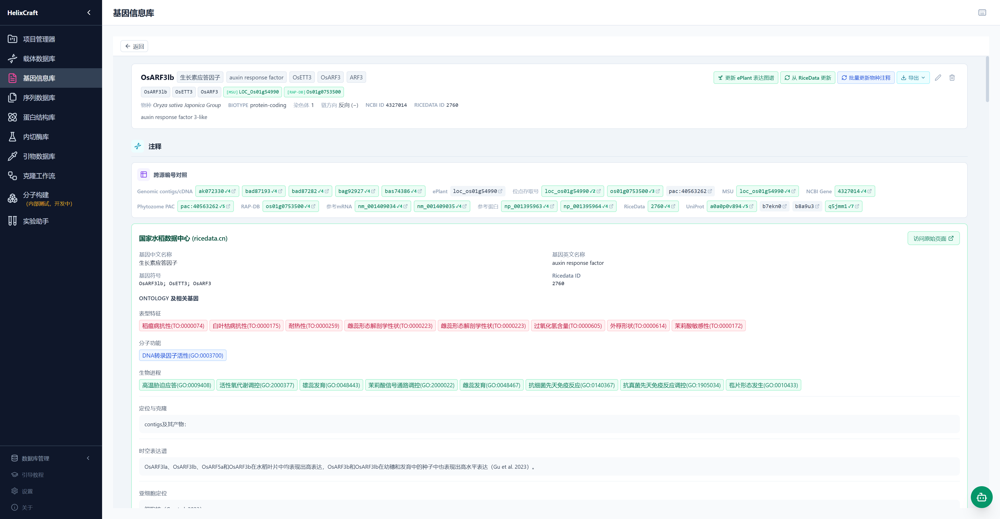
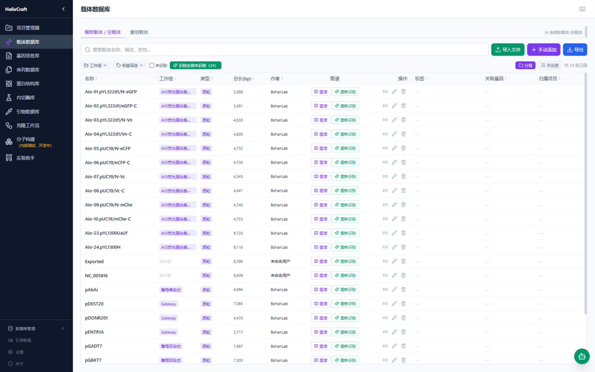
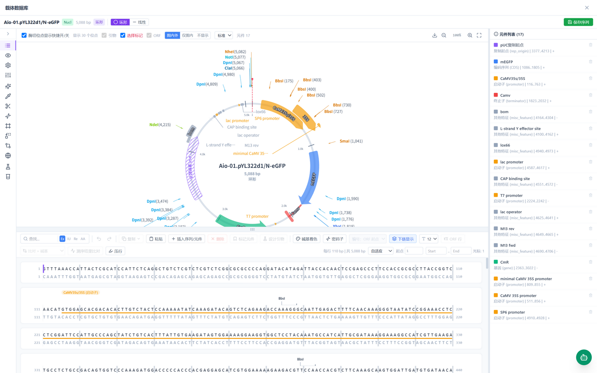
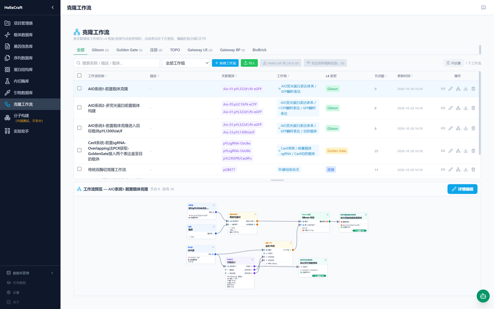
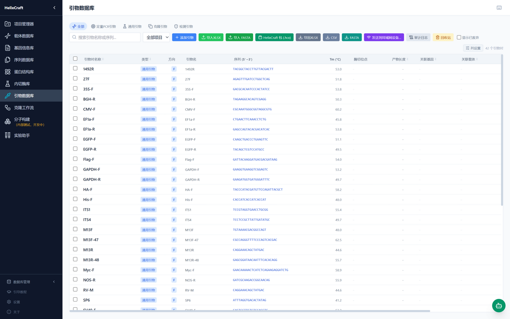
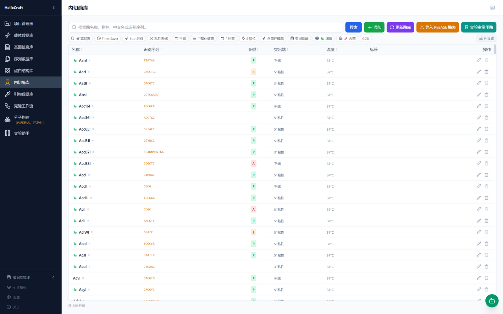
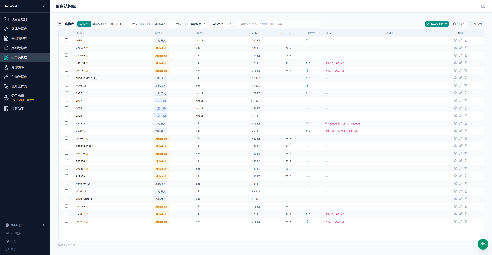
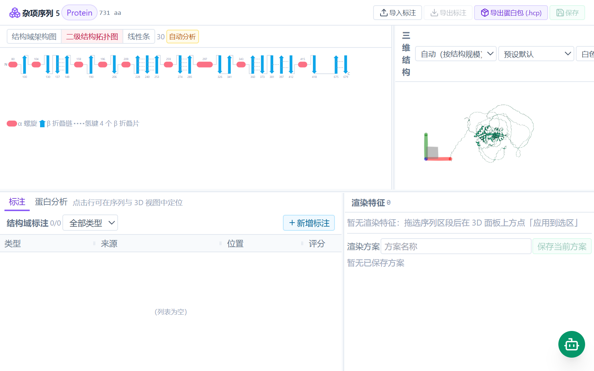
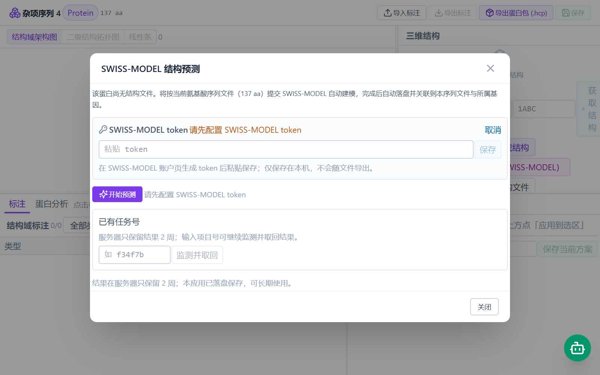
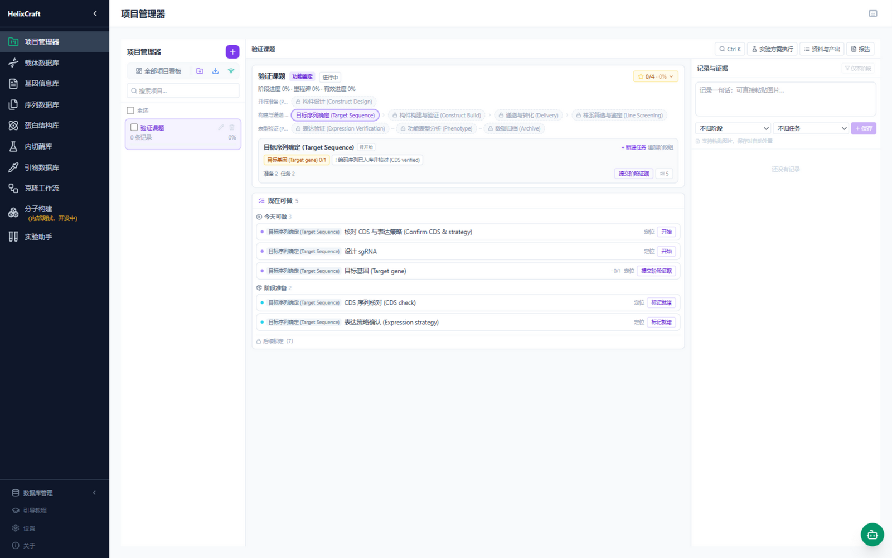

# HelixCraft

**Logiciel de bureau d'assistance à l'ingénierie génétique propulsé par l'IA** · AI-powered gene engineering tools

[简体中文](README.md) · [English](README_EN.md) · [日本語](README_ja.md) · [한국어](README_ko.md) · **Français** · [Deutsch](README_de.md) · [Español](README_es.md) · [Português](README_pt.md) · [Русский](README_ru.md) · [Italiano](README_it.md) · [العربية](README_ar.md) · [हिन्दी](README_hi.md) · [ไทย](README_th.md) · [Tiếng Việt](README_vi.md) · [Bahasa Indonesia](README_id.md) · [Türkçe](README_tr.md) · [Nederlands](README_nl.md) · [Polski](README_pl.md) · [Svenska](README_sv.md) · [Čeština](README_cs.md)

> HelixCraft est un logiciel de bureau destiné à la recherche en biologie moléculaire et en ingénierie génétique. Il couvre l'ensemble du flux de travail « trouver un gène → lire les séquences → concevoir le clonage → assembler in silico → valider expérimentalement → gérer les données » : édition de cartes de vecteurs, analyse de séquences, conception d'amorces, simulation de digestions de restriction et d'électrophorèse sur gel, workflows de clonage, analyse de chromatogrammes de séquençage, analyse de protéines et assistant IA optionnel. Toutes les données sont stockées sur votre propre ordinateur, sans compte à créer ni dépendance à un service cloud. L'interface est disponible en 20 langues.
- **Prédiction de structure SWISS-MODEL** : pour les protéines sans fichier de structure, modélisez en ligne la séquence d'acides aminés enregistrée ; le résultat est stocké localement et lié au fichier de séquence et à son gène.
> Documentation complète : [简体中文](README.md) · [English](README_EN.md)

## Nouveautés de la v0.5.0

- **Prédiction de structure SWISS-MODEL** : les protéines sans fichier de structure peuvent être modélisées en ligne à partir de la séquence d'acides aminés enregistrée ; le résultat est stocké localement et lié au fichier de séquence et à son gène. Les tâches existantes peuvent être reprises par ID de projet.
- **Gestion de projet ELN/LIMS** : registre des matériaux, mesures structurées, espaces de travail par étape, modèles, progression et rapports ; **BLAST** en ligne (avec pré-contrôle Primer-BLAST) et vérification complète des séquences avec rapport de construction par IA.
- **Guidage et plateformes** : tutoriels guidés de type cours (chapitres, reprise) ; build universal macOS 13+ (Intel et Apple Silicon) ; interface toujours en 20 langues.

## Fonctions clés

- **Récupération d'informations sur les gènes** : recherche dans la base locale, import NCBI Gene/accession, recherche via plugins d'espèces (RAP-DB / MSU / RiceData, Ensembl Plants, Phytozome), identifiants et références croisés, données d'expression (ePlant / Expression Atlas), annotations UniProt, et une page de gène réunissant allèles, phénotypes, GO/InterPro et références.
- **Cartes de vecteurs et édition de séquences** : carte circulaire/linéaire liée au texte de séquence ; sites de restriction, amorces, ORF et mutations superposés ; annotation intelligente des composants ; export SVG/PDF/PNG de qualité publication.
- **Conception de clonage** : canvas de workflow à 30 nœuds pour Gibson, Golden Gate, ligature T4, TA/TOPO, Gateway LR/BP et BioBrick ; simulation PCR, digestion et assemblage en temps réel avant le bench.
- **Conception d'amorces** : modes général, clonage et qPCR avec 50+ paramètres, scores Tm/GC/épingle/dimère, stratégies de jonction d'exons et contrôle hors cible par in-silico PCR.
- **Vérification de séquençage** : visualiseur de chromatogrammes AB1, assemblage de reads CAP3, vérification complète du vecteur recombinant (couverture, jonctions, variants, dérive de référence) avec rapport de construction par IA, alignement ClustalW et arbres.
- **Analyse et simulation de gel** : détection de pistes/bandes par apprentissage profond, quantification de taille et de quantité d'ADN à partir d'un marqueur, électrophorèse virtuelle des digestions.
- **Structure et analyse des protéines** : visualiseur 3D Mol* pour RCSB PDB / AlphaFold DB et fichiers PDB/mmCIF locaux, vues topologie ↔ séquence ↔ 3D synchronisées, structure secondaire DSSP, mesure de distances et coloration des résidus ; **prédiction SWISS-MODEL** en l'absence de structure ; analyse physico-chimique, localisation et PTM ; packages protéiques `.hcp`.
- **Données de laboratoire et collaboration** : gestion de projet ELN/LIMS (matériaux, mesures structurées, espaces par étape, modèles, rapports), bases vecteurs/gènes/amorces/séquençage, transfert LAN chiffré, sauvegardes automatiques ; tutoriels guidés ; assistant IA optionnel ; interface en 20 langues.

## Captures d'écran

## Ce que vous pouvez en faire

- Ouvrir un fichier de plasmide pour visualiser clairement ses éléments et ses sites de restriction, puis exporter une carte de qualité publication ;
- Simuler de bout en bout sur ordinateur un plan Gibson / Golden Gate / ligation par restriction avant de préparer la moindre réaction ;
- Concevoir des amorces de clonage ou des amorces qPCR à cheval sur les jonctions d'exons, avec des scores et des justifications d'évaluation détaillées ;
- Consulter des chromatogrammes de séquençage, assembler les lectures et ré-aligner les résultats sur votre vecteur recombinant pour vérification ;
- Annoter et quantifier les pistes et les bandes de la photo d'un gel ;
- Partir d'une séquence protéique pour analyser ses propriétés physico-chimiques, sa localisation subcellulaire, ses sites de modification et sa structure 3D ;
- Gérer vecteurs, gènes, amorces et fichiers de séquençage par projet, les transférer entre les ordinateurs du laboratoire et les sauvegarder régulièrement.

## Sommaire

[Téléchargement](#téléchargement) · [Installation](#installation) · [Mises à jour en ligne](#mises-à-jour-en-ligne) · [Fonctionnalités principales](#fonctionnalités-principales) · [Extensions de données d'espèces](#extensions-de-données-despèces) · [Sécurité et confidentialité des données](#sécurité-et-confidentialité-des-données)

## Téléchargement

La dernière version est toujours publiée sur le [**canal Releases · `latest`**](releases) :

| Plateforme | Installateur | Mode d'installation |
|---|---|---|
| Windows 10 / 11 (x64) | `HelixCraft.Setup.<version>.exe` | Double-cliquez pour lancer l'assistant d'installation |
| macOS 13+ (universal) | `HelixCraft.Setup.<version>.dmg` | Ouvrez le `.dmg` et glissez HelixCraft dans Applications |
| Debian / Ubuntu (x86_64) | `helixcraft_<version>_amd64.deb` | Double-cliquez pour le confier au programme d'installation graphique du système, ou `sudo apt install ./<fichier>` |

Le canal `latest` sert également de source de données à la fonction « Vérifier les mises à jour » intégrée à l'application, et ses fichiers sont remplacés à chaque version. Les versions historiques sont archivées dans la [liste des Releases](releases). Le fichier `latest.json` du même dossier est le manifeste de mise à jour utilisé par l'application : il indique pour chaque installateur le nom de fichier, la taille en octets et l'empreinte SHA-256, ce qui permet de vérifier que le téléchargement est complet et n'a pas été altéré.

## Installation

### Windows

- Prérequis : Windows 10 ou ultérieur (x64).
- Exécutez `HelixCraft.Setup.<version>.exe` et suivez l'assistant d'installation.
- L'assistant propose un composant optionnel de **données d'exemple** (vecteurs d'exemple, workflows de clonage et extensions d'espèces) pour permettre aux nouveaux utilisateurs de démarrer rapidement ; ces données ne sont importées que si le contenu correspondant n'existe pas encore et **ne remplaceront jamais les données que vous avez créées**.
- **Une installation par-dessus la version existante conserve toutes vos données.** Celles-ci résident dans `%APPDATA%\HelixCraft` (sous-bases d'espèces dans `%APPDATA%\HelixCraftData`) ; la désinstallation ne les supprime pas.

### macOS

- Configuration requise : macOS 13 ou ultérieur (universal : Intel et Apple Silicon).
- Ouvrez `HelixCraft.Setup.<version>.dmg` et glissez **HelixCraft** dans **Applications**.
- Le build est signé ad-hoc (non notarié) : au premier lancement, cliquez droit sur l'application et choisissez **Ouvrir** (ou autorisez-la dans Réglages Système → Confidentialité et sécurité). Les données utilisateur se trouvent dans `~/Library/Application Support/HelixCraft` et ne sont **pas supprimées à la désinstallation**.

### Linux (Debian / Ubuntu, x86_64)

- Double-cliquez sur le `.deb` pour le confier au programme d'installation graphique du système, ou utilisez la commande équivalente `sudo apt install ./helixcraft_<version>_amd64.deb`.
- L'application s'installe dans `/opt/HelixCraft` et les données utilisateur dans `~/.config/HelixCraft` ; **la désinstallation ne les supprime pas**.
- L'installation de polices CJK est recommandée pour un affichage correct des caractères chinois, japonais et coréens.

## Mises à jour en ligne

Environ 20 secondes après le lancement, l'application recherche des mises à jour en arrière-plan (fonction activée par défaut, au plus une fois toutes les 24 heures, désactivable dans les paramètres). La découverte d'une nouvelle version se limite à une notification — **aucun téléchargement automatique** ; le téléchargement s'effectue en HTTPS, avec reprise des transferts interrompus et vérification SHA-256, et tout installateur dont la vérification échoue est rejeté. Sous Windows, l'installation est prise en charge par l'assistant NSIS puis l'application redémarre automatiquement ; sous Linux, le `.deb` téléchargé est confié au gestionnaire d'installation du système.

## Fonctionnalités principales

- **Cartes de vecteurs** : vues circulaire et linéaire liées bidirectionnellement au texte de séquence, éléments colorés par type, superposition des sites de restriction, des positions d'amorces, des ORF et des marques de mutation ; styles entièrement personnalisables et export SVG / PDF / PNG pour vos figures de publication.
- **Édition directe des séquences** : saisie, suppression et collage libres, avec repositionnement automatique des coordonnées des éléments après chaque insertion ou suppression ; l'annulation et le rétablissement sont possibles sur 50 niveaux pour toutes les opérations sur les séquences et les éléments.
- **Annotation intelligente** : la séquence complète du vecteur est comparée à la base d'éléments pour reconnaître automatiquement les éléments connus, et les champs résistance aux antibiotiques, hôte, promoteur ou gène rapporteur sont déduits automatiquement, avec score de confiance et preuves, sans jamais écraser les informations existantes.
- **Prédiction d'ORF et recherche BLAST en ligne** : balayage des six cadres de lecture, y compris les ORF traversant l'origine des plasmides circulaires ; toute sélection peut être soumise à NCBI (blastn / blastp / blastx et autres programmes).
- **Simulation de digestions de restriction et électrophorèse virtuelle** : liste des fragments en temps réel pour les digestions simple, double ou multiple, y compris les sites à cheval sur l'origine des plasmides circulaires ; les résultats s'envoient vers la simulation de gel (11 marqueurs courants, concentration d'agarose, tension et durée de migration réglables) pour prédire si la digestion de contrôle séparera la bande d'intérêt ; contrôle automatique de la méthylation (Dam / Dcm / CpG) et assistant de choix de sites de restriction.
- **Toile de workflow de clonage** : reliez les étapes de l'expérience comme un logigramme (sources de séquences → conception d'amorces / optimisation de codons → PCR virtuelle → digestion / purification → assemblage → transformation / PCR de colonie / vérification par séquençage → enregistrement en base), soit 30 types de nœuds dont les sorties sont recalculées en temps réel ; assemblages Gibson, Golden Gate (BsaI / BbsI / BpiI / SapI), ligation T4, TA / TOPO, Gateway LR / BP et BioBrick ; la séquence complète du plasmide recombinant final peut être vérifiée avant de valider le design.
- **Toile de construction moléculaire (bêta)** : pour un design du type « choisir un squelette, y déposer des éléments » — sélectionnez le squelette dans la bibliothèque de vecteurs, comblez les espaces avec vos éléments, choisissez la méthode d'assemblage, et le logiciel génère la stratégie de linéarisation, toutes les amorces, le mélange d'assemblage, les fragments de PCR de colonie attendus et les amorces de séquençage suggérées ; l'enregistrement n'est autorisé que si le produit correspond base à base au design.
- **Conception d'amorces générales et qPCR** : plus de 50 paramètres réglables (Tm, GC, taille du produit, stabilité en 3′, etc.) ; Top 20 de candidats avec Tm, GC%, risques de hairpin et de dimères et score global sur 100 ; l'assistant qPCR réalise l'alignement d'épissage ARNm/génome et conçoit en priorité des amorces à cheval sur les jonctions d'exons, avec score de conformité MIQE et association automatique au gène ; bibliothèque d'amorces gérée par paires avec import/export Excel et historique d'audit.
- **Analyse des résultats de séquençage** : visionneuse de chromatogrammes AB1 (quatre canaux de fluorescence, valeurs de qualité, correction manuelle possible), assemblage automatique des lectures Sanger (algorithme CAP3) avec contigs, profondeur de couverture et zones de faible qualité, ré-alignement des lectures sur votre vecteur recombinant avec schéma « éléments + lectures » coloré par niveau de conservation, ainsi qu'alignement multiple (ClustalW) et construction d'arbres phylogénétiques.
- **Analyse d'images de gel par IA** : assistant en trois étapes — ouverture de la photo, détection automatique des pistes et des bandes par un modèle de deep learning intégré (ajustables à la main), puis quantification ; après choix du marqueur et d'une bande de référence, une courbe d'étalonnage des tailles est ajustée automatiquement et fournit pour chaque bande la taille du fragment et la quantité d'ADN (densité optique intégrée) ; export des images annotées (PNG / JPG / BMP / TIF) et des résultats JSON.
- **Analyse de protéines** : trois vues liées (schéma topologique ↔ séquence d'acides aminés ↔ structure 3D récupérée depuis RCSB PDB / AlphaFold DB) avec surlignage synchronisé ; analyses locales instantanées (masse moléculaire, point isoélectrique, hydrophobicité, composition, localisation subcellulaire, sites de modification post-traductionnelle, régions désordonnées ou antigéniques) ; affinement en ligne par InterProScan et BLAST avec transfert des annotations vérifiées Swiss-Prot.
- **Gestion des données de laboratoire** : cinq bases de données (vecteurs, séquences, amorces, plus de 580 enzymes de restriction, projets) ; un groupe de travail entier de vecteurs peut être empaqueté en un fichier `.hcvec` pour un collègue, et deux ordinateurs du même réseau local échangent des données via un canal chiffré à code d'appairage de 8 chiffres, la réception ne complétant que les champs vides ; sauvegardes automatiques au démarrage, sauvegarde manuelle complète et restauration en un clic ; toute suppression liste d'abord les données associées affectées.
- **Assistant IA optionnel** : après configuration d'un point d'accès compatible OpenAI (clé API conservée uniquement sur votre machine), il comprend le texte des protocoles de clonage pour en extraire un schéma structuré, perçoit le gène / vecteur / fenêtre ouverts et peut piloter le logiciel par le même chemin que l'édition manuelle — **l'IA ne produit jamais la moindre séquence de bases** ; sans configuration d'IA, chaque fonction dispose d'un chemin purement manuel et le logiciel reste intégralement utilisable.

## Extensions de données d'espèces

Les annotations de gènes et les données d'expression sont intégrées via des « extensions d'espèces », installables, activables ou désinstallables depuis la page des paramètres. Le paquet d'installation embarque les annotations du riz (environ 100 000 entrées), et les annotations, séquences ou images obtenues en ligne sont automatiquement enregistrées dans un cache local relu par défaut — tout reste consultable même hors ligne. Quatre extensions sont disponibles :

- **Riz** — sources RAP-DB, MSU-RGAP, RiceData et RiceXPro : annotations de loci, structure exonique, synonymes, phénotypes de mutants, cartes d'expression spatio-temporelle (valeurs et images), séquences de toutes les versions et conversion d'identifiants entre bases ;
- **Ensembl Plants** — sources Ensembl Plants et EBI Expression Atlas : recherche de gènes dans plus de 100 espèces, téléchargement de séquences, annotations GO et expression RNA-Seq ;
- **Phytozome** — source JGI Phytozome : recherche de gènes, modèles de gènes, séquences CDS / cDNA / protéiques, domaines et gènes homologues ;
- **ePlant (BAR)** — source BAR eFP Browser : pictogrammes colorés d'expression tissulaire et niveaux d'expression par tissu pour 13 espèces.

## Sécurité et confidentialité des données

- **Toutes les données restent stockées localement** : rien n'est envoyé sur un serveur ; les accès réseau n'ont lieu que lorsque vous demandez explicitement des données en ligne (NCBI, bases de données d'espèces, banques de structures protéiques, mises à jour du logiciel).
- **L'IA est entièrement optionnelle** : l'assistant exige votre propre clé API, conservée uniquement sur votre machine ; sans configuration d'IA, toutes les fonctions disposent d'un chemin manuel.
- **Les fusions n'écrasent rien** : l'installation des données d'exemple, l'import de paquets et la réception en réseau local ne font que compléter les champs vides, sans toucher à votre contenu existant.

## Langues de l'interface

Toutes les fonctions sont intégralement traduites en 20 langues depuis la v0.3.7 : 简体中文, English, 日本語, 한국어, Français, Deutsch, Español, Português, Русский, Italiano, العربية, हिन्दी, ไทย, Tiếng Việt, Bahasa Indonesia, Türkçe, Nederlands, Polski, Svenska, Čeština — la langue se change à tout moment dans « Paramètres → Langue ».

## À propos de ce dépôt

Ce dépôt sert uniquement à **distribuer les installateurs et le manifeste de mise à jour en ligne** ; il ne contient pas le code source. Le Release du tag `latest` constitue le canal de mise à jour en ligne (fichiers remplacés à chaque version), et les tags `v<version>` archivent les versions historiques. Le même dépôt est hébergé en miroir sur [GitHub](https://github.com/liudab/HelixCraft) et [GitCode](https://gitcode.com/BohanLab/HelixCraft), les installateurs y sont publiés simultanément, et la fonction « Vérifier les mises à jour » de l'application lit le canal `latest` de GitHub (téléchargement automatiquement passé par des miroirs d'accélération).

## Licence

[MIT](LICENSE)

## Contact

Bohan Liu @ BohanLab · liubohan@hunau.edu.cn
