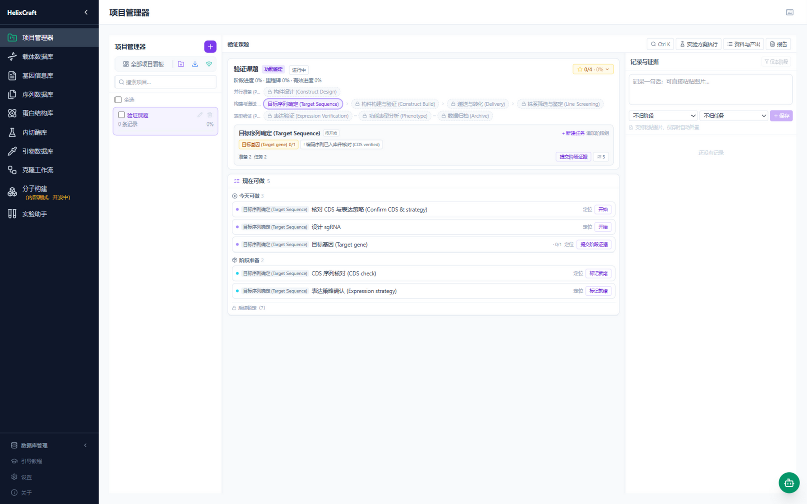
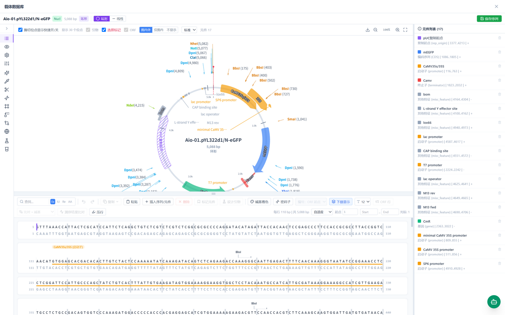
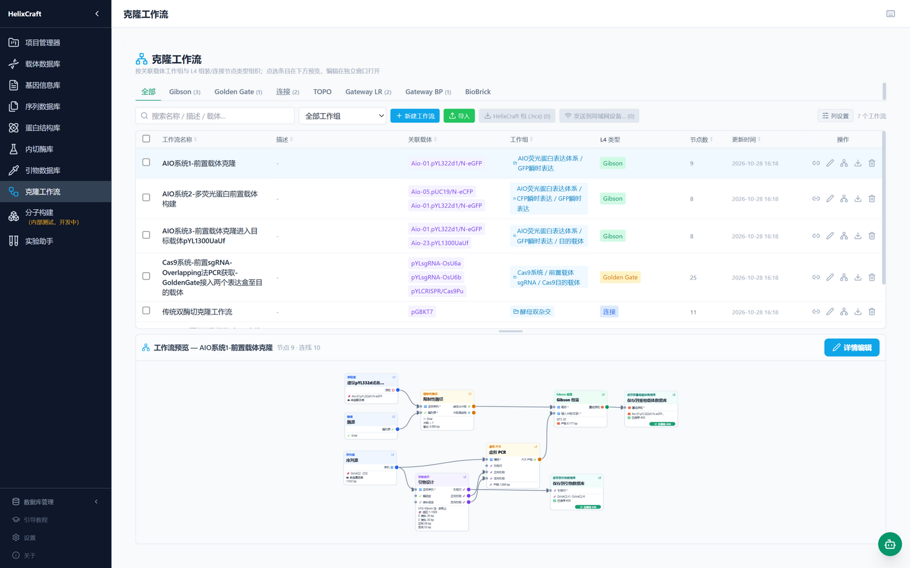
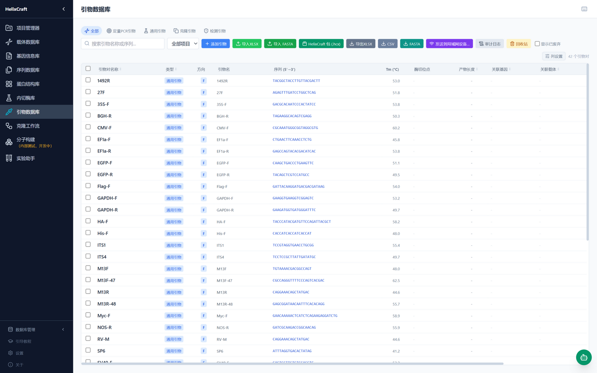

# HelixCraft

**AI 기반 유전공학 지원 데스크톱 소프트웨어** · AI-powered gene engineering tools

[简体中文](README.md) · [English](README_EN.md) · [日本語](README_ja.md) · **한국어** · [Français](README_fr.md) · [Deutsch](README_de.md) · [Español](README_es.md) · [Português](README_pt.md) · [Русский](README_ru.md) · [Italiano](README_it.md) · [العربية](README_ar.md) · [हिन्दी](README_hi.md) · [ไทย](README_th.md) · [Tiếng Việt](README_vi.md) · [Bahasa Indonesia](README_id.md) · [Türkçe](README_tr.md) · [Nederlands](README_nl.md) · [Polski](README_pl.md) · [Svenska](README_sv.md) · [Čeština](README_cs.md)

> HelixCraft는 분자생물학과 유전공학 연구를 위한 데스크톱 소프트웨어로, "유전자 조회 → 서열 판독 → 클로닝 설계 → 가상 조립 → 실험 검증 → 데이터 관리"로 이어지는 전체 워크플로를 하나의 앱 안에서 지원합니다.
> 벡터 맵 편집, 서열 분석, 프라이머 설계, 제한효소 절단 및 겔 전기영동 시뮬레이션, 클로닝 워크플로, 시퀀싱 크로마토그램 분석, 종 데이터 조회, 단백질 분석과 선택형 AI 어시스턴트를 갖추고 있습니다.
> 모든 데이터는 사용자 자신의 컴퓨터에만 저장되며 계정 등록이나 클라우드 의존 없이 사용할 수 있습니다. 인터페이스는 20개 언어를 지원합니다.
> 전체 문서: [简体中文](README.md) · [English](README_EN.md)

## v0.5.0 새 기능

- **SWISS-MODEL 구조 예측**: 구조 파일이 없는 단백질은 저장된 아미노산 서열로 온라인 모델링할 수 있습니다. 결과는 로컬에 저장되고 해당 서열 파일과 소속 유전자에 연결됩니다. 기존 작업은 프로젝트 ID로 모니터링을 재개할 수 있습니다.
- **ELN/LIMS 프로젝트 관리**: 재료 대장, 구조화 측정, 단계 작업 공간, 템플릿, 진행률 및 보고서. **BLAST** 온라인 검색(Primer-BLAST 사전 확인)과 AI 구축 보고서가 포함된 전장 서열 검증을 추가했습니다.
- **안내 및 플랫폼**: 장/중단점이 있는 코스형 가이드 투어. macOS 13+ universal 빌드(Intel/Apple Silicon). UI는 20개 언어를 유지합니다.

## 주요 기능 요약

- **유전자 정보 조회**: 로컬 유전자 라이브러리 검색, NCBI Gene/액세션 가져오기, 종 플러그인 조회(RAP-DB / MSU / RiceData, Ensembl Plants, Phytozome), 교차 소스 ID와 참조, 발현 데이터(ePlant / Expression Atlas), UniProt 주석, 대립유전자·표현형·GO/InterPro·문헌을 모은 유전자 상세 페이지.
- **벡터 맵 및 서열 편집**: 원형/선형 맵과 서열 텍스트 양방향 연동; 제한효소 부위·프라이머 결합·ORF·돌연변이 오버레이; 구성요소 스마트 주석; 출판용 SVG/PDF/PNG 내보내기.
- **클로닝 설계**: Gibson, Golden Gate, T4 결합, TA/TOPO, Gateway LR/BP, BioBrick을 지원하는 30개 노드 워크플로 캔버스; 실험 전 PCR·절단·조립 실시간 시뮬레이션.
- **프라이머 설계**: 일반/클로닝/qPCR 모드, 50+ 파라미터, Tm/GC/헤어핀/다이머 점수, 엑손 경계 전략, in-silico PCR 오프타깃 검사.
- **시퀀싱 검증**: AB1 크로마토그램 뷰어, CAP3 리드 어셈블리, 재조합 벡터 전장 검증(커버리지/접합부/변이/참조 편차)과 AI 구축 보고서, ClustalW 정렬 및 계통수.
- **겔 분석 및 시뮬레이션**: 딥러닝 레인/밴드 검출, 마커 기반 단편 크기와 DNA 양 정량, 절단 결과 가상 겔 전기영동.
- **단백질 구조 및 분석**: Mol* 3D 뷰어로 RCSB PDB / AlphaFold DB 및 로컬 PDB/mmCIF 지원, 토폴로지↔서열↔3D 연동, DSSP 2차 구조, 거리 측정, 잔기 색상 지정; 구조가 없으면 **SWISS-MODEL 예측**; 이화학적 성질·국소화·PTM 분석; `.hcp` 단백질 패키지.
- **실험 데이터 및 협업**: ELN/LIMS 프로젝트 관리(재료, 구조화 측정, 단계 작업공간, 템플릿, 보고서), 벡터/유전자/프라이머/시퀀싱 DB, 암호화 LAN 전송, 자동 백업; 코스형 가이드; 선택적 AI 어시스턴트; 20개 언어 UI.

## 스크린샷

## 주요 활용 시나리오

- 플라스미드 맵 파일을 열어 구성 요소와 제한효소 절단 부위를 한눈에 파악하고, 논문용 맵 그림으로 내보낼 수 있습니다.
- 실험을 조제하기 전에 Gibson / Golden Gate / 제한효소-연결 클로닝 계획을 컴퓨터에서 처음부터 끝까지 시뮬레이션할 수 있습니다.
- 클로닝 프라이머나 엑손 접합부를 넘는 qPCR 정량 프라이머를 점수와 평가 근거와 함께 설계할 수 있습니다.
- 시퀀싱 크로마토그램을 확인하고 리드를 조립한 뒤, 그 결과를 재조합 벡터에 정렬하여 검증할 수 있습니다.
- 겔 사진에 레인/밴드 주석을 달고 정량 분석을 수행할 수 있습니다.
- 단백질 서열로부터 이화학적 성질, 세포 내 위치, 번역 후 수정 부위, 3차원 구조를 분석할 수 있습니다.
- 연구 과제별로 벡터·유전자·프라이머·시퀀싱 파일을 관리하고, 연구실 컴퓨터 간 전송과 주기적인 백업을 할 수 있습니다.

## 다운로드

최신 버전은 항상 [**Releases · latest 채널**](releases)에 있습니다:

| 플랫폼 | 설치 패키지 | 설치 방법 |
|---|---|---|
| Windows 10 / 11 (x64) | `HelixCraft.Setup.<version>.exe` | 더블클릭하여 설치 마법사 실행 |
| macOS 13+(universal) | `HelixCraft.Setup.<version>.dmg` | `.dmg`를 열고 HelixCraft를 응용 프로그램으로 드래그 |
| Debian / Ubuntu (x86_64) | `helixcraft_<version>_amd64.deb` | 더블클릭하여 시스템 그래픽 설치 관리자에 넘기거나 `sudo apt install ./<파일>` |

latest 채널은 앱 내 "업데이트 확인" 기능의 데이터 소스이기도 하며, 자산은 버전이 바뀔 때마다 교체됩니다. 이전 버전은 [Releases 목록](releases)에서 확인할 수 있고, 같은 디렉터리의 `latest.json`에는 각 설치 패키지의 SHA-256 해시가 기록되어 있어 다운로드 무결성을 검증할 수 있습니다.

## 설치

### Windows

- `HelixCraft.Setup.<version>.exe`를 더블클릭하여 설치 마법사를 진행합니다.
- 선택 구성 요소 **예제 데이터**(예제 벡터, 클로닝 워크플로, 종 데이터 플러그인)는 해당 내용이 아직 없을 때만 가져오며, **기존 데이터를 절대 덮어쓰지 않습니다**.
- **기존 버전 위에 덮어쓰기 설치해도 모든 데이터가 그대로 유지됩니다.** 데이터 디렉터리는 `%APPDATA%\HelixCraft`(종 서브 데이터베이스는 `%APPDATA%\HelixCraftData`)이며, 제거해도 삭제되지 않습니다.

### macOS

- 요구 사항: macOS 13 이상(universal: Intel 및 Apple Silicon).
- `HelixCraft.Setup.<version>.dmg`를 열고 **HelixCraft**를 **응용 프로그램**으로 드래그하세요.
- 빌드는 ad-hoc 서명(공증 없음)입니다. 첫 실행 시 앱을 마우스 오른쪽 버튼으로 클릭하고 **열기**를 선택하거나 시스템 설정 → 개인정보 보호 및 보안에서 허용하세요. 사용자 데이터는 `~/Library/Application Support/HelixCraft`에 있으며 제거해도 삭제되지 않습니다.

### Linux (Debian / Ubuntu, x86_64)

- `.deb` 파일을 더블클릭하면 시스템 그래픽 설치 관리자로 열리고, 터미널에서는 `sudo apt install ./helixcraft_<version>_amd64.deb`로 설치할 수 있습니다.
- 프로그램은 `/opt/HelixCraft`에, 사용자 데이터는 `~/.config/HelixCraft`에 저장되며 **제거 시에도 삭제되지 않습니다**.
- 한국어·중국어·일본어(CJK) 글꼴이 시스템에 설치되어 있는 것을 권장합니다.

## 온라인 업데이트

앱 시작 약 20초 후 백그라운드에서 업데이트를 확인합니다(기본값은 켜짐, 24시간에 최대 1회, 설정에서 끌 수 있음). 새 버전을 발견하면 알림만 표시하고 **자동으로 내려받지 않습니다**. 다운로드는 HTTPS와 이어받기, SHA-256 검증으로 보호되며, Windows에서는 NSIS 마법사가 설치를 마친 뒤 앱을 자동으로 재시작하고, Linux에서는 내려받은 `.deb`를 시스템 소프트웨어 설치 관리자에 넘깁니다.

## 주요 기능

- **벡터 맵**: 원형/선형 맵과 서열 텍스트가 양방향으로 연동되고, 맵 스타일(색, 글꼴 크기, 범례, 표시 항목)을 자유롭게 꾸밀 수 있으며 SVG / PDF / PNG 등으로 내보낼 수 있습니다.
- **서열 직접 편집**: 입력·삭제·붙여넣기를 지원하고, 삽입/삭제 후 구성 요소 좌표가 자동으로 조정되며, 모든 작업은 50단계 실행 취소/다시 실행을 지원합니다.
- **스마트 주석**: 벡터 전체 서열을 구성 요소 데이터베이스와 정렬하여 알려진 요소를 자동으로 인식하고, 항생제 내성·숙주·프로모터·리포터 유전자 등 필드를 신뢰도와 근거와 함께 추론합니다.
- **ORF 예측과 BLAST 온라인 검색**: 6프레임 스캔(원형 플라스미드의 원점을 넘는 ORF 포함)과 선택 서열의 NCBI BLAST 검색을 지원합니다.
- **제한효소 절단 시뮬레이션 + 가상 겔 전기영동**: 절단 결과를 겔 시뮬레이션으로 보내 밴드 위치를 미리 예측하고, 메틸화(Dam / Dcm / CpG) 영향도 자동으로 점검합니다.
- **클로닝 워크플로 캔버스와 분자 빌드 캔버스**: 30종 노드로 실험을 흐름도처럼 연결해 모든 노드의 출력을 실시간으로 계산하며, Gibson / Golden Gate / Gateway / TOPO / BioBrick 등 조립 전략을 지원합니다.
- **범용·qPCR 프라이머 설계**: 50개 이상의 파라미터 조정, 엑손 접합부를 넘는 qPCR 프라이머(스플라이싱 정렬, MIQE 준수 점수), 가상 PCR 검증과 프라이머 라이브러리를 제공합니다.
- **시퀀싱 결과 분석**: 크로마토그램 뷰어, CAP3 기반 리드 조립, 재조합 벡터 검증 정렬을 지원합니다.
- **겔 이미지 AI 분석**: 내장 딥러닝 모델이 레인과 밴드를 자동으로 인식하고, IOD(적분 광학 밀도)법으로 각 밴드의 크기와 DNA 양을 정량합니다.
- **단백질 분석**: 토폴로지도·아미노산 서열·3차원 구조의 3뷰 연동, 로컬 즉시 분석 + InterProScan 온라인 정밀 분석을 지원합니다.
- **실험실 데이터 관리**: 벡터·서열·프라이머·효소·프로젝트 5개 데이터베이스, 패키지 공유, LAN 페어링 암호화 상호 전송, 자동 백업, 삭제 보호를 제공합니다.
- **선택형 AI 어시스턴트**: 클로닝 계획 텍스트를 이해하고 소프트웨어를 직접 조작합니다. AI를 설정하지 않아도 모든 기능은 수동 경로로 완전하게 사용할 수 있습니다.

## 종 데이터 플러그인

유전자 주석과 발현 데이터는 "종 데이터 플러그인"으로 연결됩니다. 설치 패키지에는 벼 주석 데이터(약 10만 건)가 포함되어 있으며, 온라인에서 가져온 주석·서열·이미지는 자동으로 로컬에 캐시되어 오프라인에서도 볼 수 있습니다.

- **벼(Rice)** — RAP-DB, MSU-RGAP, RiceData, RiceXPro
- **Ensembl Plants** — Ensembl Plants, EBI Expression Atlas
- **Phytozome** — JGI Phytozome
- **ePlant(BAR)** — BAR eFP Browser

## 데이터 보안 및 프라이버시

- **모든 데이터는 로컬에 저장됩니다**: 어떤 서버로도 업로드되지 않으며, 네트워크 접속은 사용자가 온라인 데이터를 직접 요청할 때만 발생합니다.
- **AI는 완전히 선택 사항입니다**: API 키는 로컬에만 저장되며, AI를 설정하지 않아도 모든 기능에 수동 경로가 있습니다.
- **병합은 덮어쓰지 않습니다**: 예제 데이터 설치, 데이터 패키지 가져오기, LAN 수신은 모두 빈 필드만 채우고 기존 내용은 건드리지 않습니다.

## 지원 파일 형식

| 방향 | 형식 |
|------|------|
- **SWISS-MODEL 구조 예측**: 구조 파일이 없는 단백질은 현재 아미노산 서열로 온라인 모델링할 수 있으며, 결과는 로컬에 저장되어 서열 파일과 소속 유전자에 연결됩니다.
| 열기 / 가져오기 | GenBank(`.gb` `.gbk`), FASTA(`.fasta` `.fa` `.faa`), SnapGene(`.dna`), EMBL(`.embl`), 시퀀싱 크로마토그램(`.ab1`), 프라이머 Excel(`.xlsx`), 단백질 주석(UniProtKB / GFF3 / InterProScan / GenPept), 단백질 구조(PDB / mmCIF), HelixCraft 패키지(유전자 패키지 / `.hcvec` 벡터 패키지 / `.hcp` 단백질 패키지) |
| 저장 / 내보내기 | GenBank, FASTA, SnapGene `.dna`, EMBL, 맵 그림(SVG / PDF / PNG / JPG / BMP / TIF), 주석 달린 겔 그림, 프라이머 Excel, 6종 형식의 단백질 주석, 유전자 데이터 패키지 / `.hcvec` / `.hcp`, 유전자 상세 정적 웹페이지, 전체 백업 ZIP |

## 인터페이스 언어

v0.3.7부터 모든 기능 모듈이 20개 언어를 완전히 지원합니다: 简体中文, English, 日本語, 한국어, Français, Deutsch, Español, Português, Русский, Italiano, العربية, हिन्दी, ไทย, Tiếng Việt, Bahasa Indonesia, Türkçe, Nederlands, Polski, Svenska, Čeština. "설정 → 언어"에서 언제든 전환할 수 있습니다.

## 이 저장소에 대하여

이 저장소는 **설치 패키지와 온라인 업데이트 매니페스트만 배포**하며 소스 코드는 포함하지 않습니다. `latest` 태그의 릴리스가 온라인 업데이트 채널(자산은 버전이 바뀔 때마다 교체)이고, `v<버전>` 태그의 릴리스는 이전 버전 아카이브입니다.

동일한 저장소가 [GitHub](https://github.com/liudab/HelixCraft)과 [GitCode](https://gitcode.com/BohanLab/HelixCraft)에 동기화되어 호스팅되며, 설치 패키지는 양쪽에 함께 게시됩니다.

## 라이선스

[MIT](LICENSE)

## 연락처

Bohan Liu @ BohanLab · liubohan@hunau.edu.cn
